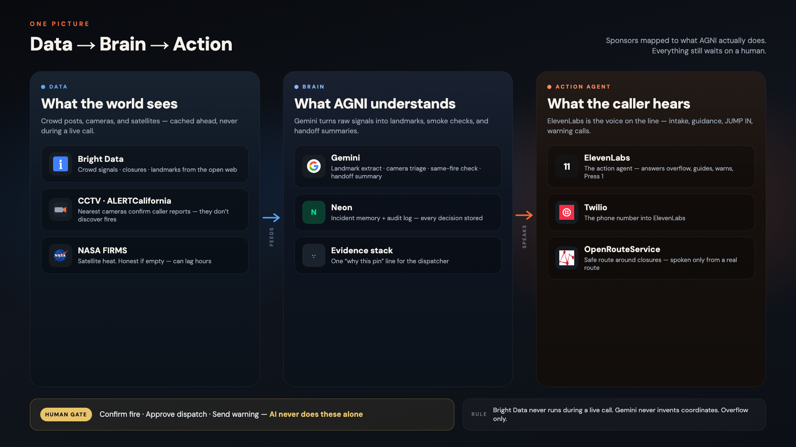

# AGNI

**AI Agent that helps people get out of a fire’s path.**

When 911 is flooded, AGNI answers the overflow call, fuses what callers say with **live web signals**, and puts one clear picture in front of a human dispatcher — so a unit and a warning go out faster, and AI never decides alone.

> We don’t replace 911. We catch the calls that get dropped today.

**SanD Hacks · UC San Diego · Nov 14–15, 2026** · [github.com/bjiby02/agni](https://github.com/bjiby02/agni)  
**Track:** Bright Data — *Data for Good*

---

## Why web data matters here

In the Eaton fire, smoke reports sat in 911 logs for hours before west Altadena got an evacuation order. The public already talks about fire online — Reddit, search, road closures, shelter pages — but that signal rarely reaches a dispatcher in time.

AGNI turns that open-web noise into **cached, usable context** before a call ever starts: where people say “smoke,” which roads are closed, which landmarks they actually name, whether a shelter still has room. On the live call the voice agent only reads those tables — **Bright Data never runs while someone is on the line**.

That is Data for Good in one loop: **scrape the open web → fuse with the caller → human confirms → route and warn.**

---

## Bright Data in the product (not a logo)

| Bright Data use | What AGNI does with it | Social impact |
|-----------------|------------------------|---------------|
| **SERP (last hour)** | “Smoke / fire” near Torrey Pines, Carmel Valley, La Jolla… → crowd signals on the map | Surface unverified public reports early — gray pins, never auto-dispatch |
| **Reddit / X scrapers** | Local posts about smoke → Gemini classifies → attach to a fire row | Same fire, fewer duplicate units |
| **Browser API** | Caltrans QuickMap closures + shelter capacity pages | Route around closed roads; refuse full/unsafe shelters |
| **Landmark list (cached)** | Names people say (“the Vons,” Atkinson Hall, Jacobs) → pin from a list | Callers without a street address still get a location |

Crowd posts **raise priority**. They **never** send a truck. Unknown stays gray.

---

## What the product does

- **Overflow voice** — ElevenLabs answers in the caller’s language (≤3 questions)
- **Landmark pins** — speech → cached place list (Gemini never invents coordinates)
- **One row per fire** — suggest merge · Accept / Keep apart / Undo
- **Cameras confirm** — nearest ALERTCalifornia stills check the report; they don’t invent fires
- **Evidence stack** — callers · cams · **web posts** · FIRMS · NIFC · wind → one “why this pin” line
- **Safe route + dispatch** — nearest unit, avoid Bright Data closures, refuse downwind shelters; human Approves
- **JUMP IN** — dispatcher takes the line with a Gemini handoff summary
- **30-min spread ring** — wind estimate, labeled estimate
- **Targeted warning** — opt-in list only; Press 1 → rescue pin
- **After-action** — clock from the event log; human signs

---

## Data → Brain → Action

Sponsors mapped to what AGNI actually does. Everything still waits on a human.



| | Layer | What it is |
|--|-------|------------|
| **Data** | Cached ahead · never during a live call | **Bright Data** — crowd, closures, landmarks · **CCTV · ALERTCalifornia** — confirm callers · **NASA FIRMS** — honest if empty |
| **FEEDS → Brain** | What AGNI understands | **Gemini** — landmarks, triage, same-fire, handoff · **Neon** — memory + audit · **Evidence** — “why this pin” |
| **SPEAKS → Action** | What the caller hears | **ElevenLabs** · **Twilio** · **OpenRouteService** (spoken ETA only from a real route) |

**HUMAN GATE** — Confirm fire · Approve dispatch · Send warning — AI never does these alone.

---

## Try it

```sh
cp .env.example .env
pip install -r backend/requirements.txt && make seed
AGNI_MOCK=1 make demo          # 5-minute mock, no keys
make dev                       # API :8000 · frontend :5173
```

Promo for Bright Data credits: `sandhacks26` · status: [`STATUS.md`](STATUS.md) · demo: [`DEMO_FLOW.md`](DEMO_FLOW.md)

---

## Repo

| Path | What |
|------|------|
| `backend/` | FastAPI · Bright Data pollers · Gemini · SSE console API |
| `frontend/` | Dispatcher map · fire rows · evidence · keyboard |
| `agent/` | ElevenLabs prompt + webhook tools |
| `seed/` | Landmarks, shelters, units, opt-in warn list |
| `docs/pitch/` | Pitch slides + architecture |

**Built with:** Bright Data · ElevenLabs · Gemini · Neon · Twilio · NASA FIRMS · OpenRouteService · ALERTCalifornia · NWS / NIFC
